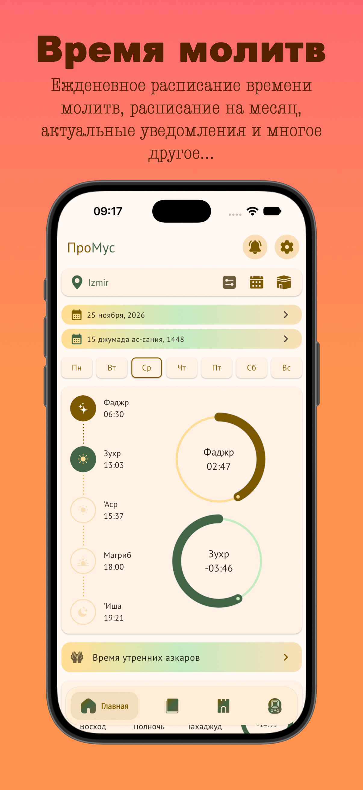
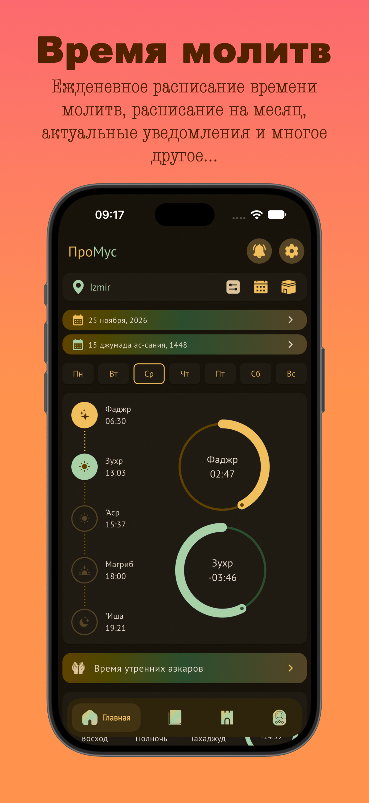
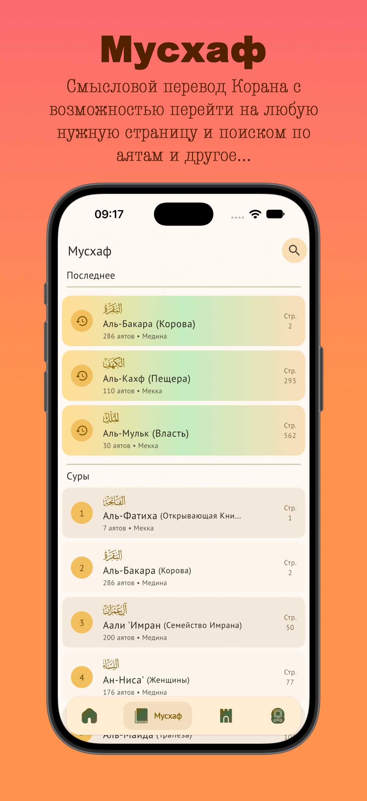
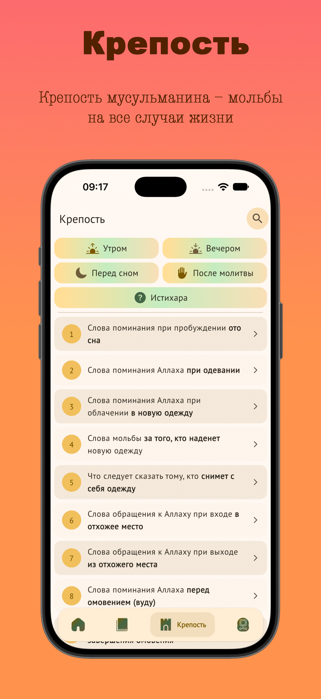
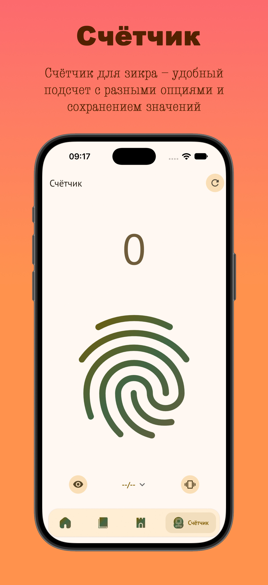

 

<h1 align="center">ПроМус — Провизия мусульманина</h1>

  <b>Твоя благая провизия!</b> 
  Время молитв, Мусхаф, «Крепость мусульманина» и тасбих — в одном приложении.

  <a href="https://github.com/JMApps/promus/releases/latest/download/ProMus-arm64.apk"><b>⬇️ Скачать для Android</b></a>
  &nbsp;·&nbsp;
  <a href="https://github.com/JMApps/promus/releases/latest">Все версии</a>

  
  
  
  
  

---

## О приложении

**ПроМус** — бесплатное приложение для мусульман на русском языке. Оно помогает вовремя совершать намаз, читать Коран и поминать Аллаха в течение дня. Без регистрации, без входа в аккаунт и без рекламы.

## Возможности

### 🕌 Время молитв
- Ежедневное расписание: Фаджр, восход, Зухр, Аср, Магриб, Иша
- Расписание на месяц
- Обратный отсчёт до следующей молитвы
- Время полуночи и последней трети ночи (для тахаджуда)
- Дата по григорианскому и хиджрийскому календарю
- Выбор города
- Методы расчёта, в том числе для **России, Татарстана, Дагестана, Чечни** и Франции

### 🔔 Уведомления
- Напоминания о времени каждой молитвы
- Настройка времени до икамы
- Напоминания об утренних и вечерних азкарах

### 📖 Мусхаф
- Смысловой перевод Корана
- Быстрый переход к нужной странице, суре и аяту

### 🛡 Крепость мусульманина
- Мольбы (дуа) на все случаи жизни из сборника «Хисн аль-муслим»

### 📿 Счётчик (тасбих)
- Удобный счётчик для зикра
- Режимы: свободный, 33, 100, 1000
- Виброотклик и сохранение значения

### 🎨 Оформление
- Светлая и тёмная тема

## Установка на Android

1. Скачайте **[ProMus-arm64.apk](https://github.com/JMApps/promus/releases/latest/download/ProMus-arm64.apk)**.
   Если не устанавливается (старые телефоны) — [ProMus-armv7.apk](https://github.com/JMApps/promus/releases/latest/download/ProMus-armv7.apk).
2. Откройте файл и разрешите установку из неизвестных источников, если телефон попросит.
3. Для обновления скачайте новую версию по той же ссылке и установите поверх: настройки сохранятся.

## iOS

Скоро в App Store.

## Обратная связь

Нашли ошибку или есть предложение? Создайте [Issue](https://github.com/JMApps/promus/issues) или напишите: jmappsmuslim@gmail.com

---

JM Apps

